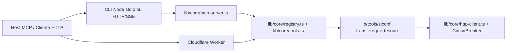

# Arquitetura AS-IS

Base atual: `TCK-0001` (`v0.1.0`, `ADR-0001`, implementado).

Arquitetura dual-runtime herdada do molde `mcp-dadosbr`:
- **Node.js CLI (`lib/bin/mcp-orcamento.ts` -> `lib/adapters/cli.ts`, `cli-http.ts`):** transportes `stdio` e `HTTP/SSE` + `StreamableHTTPServerTransport`, métricas `[metrics]` e logs JSON exclusivamente em `stderr`, `MemoryCache`, `RateLimiter` e encerramento gracioso (`shutdownStdio` / `RunningHttpServer.close()`).
- **Cloudflare Workers (`lib/adapters/cloudflare.ts` -> `lib/workers/*`):** runtime serverless *stateless* sem imports `node:*` na camada core/shared/tools/workers, cache/rate-limit em KV, REST genérico `POST /tools/{toolName}` e OpenAPI 3.0.
- **Camada acíclica (`lib/tools/` -> `lib/core/` -> `lib/shared/`):** `lib/core/` não importa `lib/tools/`.

## Fontes

- `.archagents/09-decisions/ADR-0001-dual-runtime-node-cloudflare-worker.md`
- `tsconfig.json`
- `tsconfig.worker.json`
