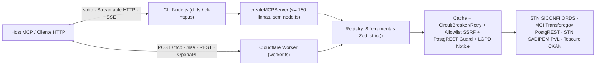

# MCP Orçamento `by Orqo`

**Orçamento público, LRF e transferências federais na conversa com IA. Com fonte, proveniência e limites declarados.**

[](https://orqo.pro/)
[](https://www.npmjs.com/package/@aredes.me/mcp-orcamento)
[](LICENSE)
[](package.json)
[](#catálogo-completo-das-8-ferramentas)

[O problema](#o-problema) · [Experimente](#experimente-em-uma-conversa) · [8 ferramentas](#catálogo-completo-das-8-ferramentas) · [Ecossistema](#sinergia-no-ecossistema-aredesme) · [Perímetro](#perímetro-de-execução) · [Instalação](#instalação-e-configuração) · [Por dentro](#como-funciona-por-dentro) · [O que não faz](#honestidade-o-que-o-mcp-orçamento-não-faz) · [Governança](#governança-construído-com-codebase-ops-by-orqo) · [Perguntas](#perguntas-diretas) · [AGPL-3.0](#licença-gnu-agpl-30) · [LGPD](#privacidade-e-lgpd) · [English](#english)

---

O **MCP Orçamento** (`@aredes.me/mcp-orcamento`, `v0.1.0`) é um servidor open source do [Model Context Protocol (MCP)](https://modelcontextprotocol.io/) desenvolvido pela [Orqo](https://orqo.pro/) que conecta assistentes de IA como Claude, Cursor, Windsurf e VS Code a **8 ferramentas somente leitura de orçamento público brasileiro, execução fiscal (Lei de Responsabilidade Fiscal), transferências federais e operações de crédito subnacionais** — consultando diretamente as APIs oficiais do **SICONFI (Tesouro Nacional)**, **Transferegov (MGI)**, **SADIPEM/PVL** e **Tesouro Transparente (CKAN)**.

- **Zero chave de API em 100% das 8 ferramentas** — todas as consultas ao SICONFI, Transferegov, SADIPEM e CKAN funcionam sem cadastro prévio nem parâmetro `api_key`.
- **Proveniência explícita, guarda agêntico e LGPD** — toda resposta entrega `source.url` e `fetchedAt`, inclui `untrusted_data_notice` após sanitização recursiva e adiciona `lgpd_notice` (LGPD Art. 20) em consultas nominais ou parlamentares.
- **Runtime dual: local ou na borda** — CLI Node.js (`stdio`, Streamable HTTP `/mcp` e `HTTP/SSE`) ou Cloudflare Worker serverless com JSON-RPC `POST /mcp`, `/sse`, REST genérico `POST /tools/{toolName}`, `GET /health` e OpenAPI 3.0.3 (`/openapi.json`).
- **Software livre AGPL-3.0 com rastro público** — especificado, endurecido e verificado com [Codebase OPS by Orqo](https://orqo.pro/).

---

## O problema

### Seu assistente sabe citar a Lei de Responsabilidade Fiscal. Não sabe se um município entregou o RREO deste bimestre ou quanto recebeu de Emendas Pix.

Pedir números de execução orçamentária, despesas com pessoal, transferências especiais ou pleitos de endividamento "de memória" a um modelo de linguagem mistura regras gerais com cifras inventadas ou defasadas. Para auditoria cívica, jornalismo de dados, controladoria municipal ou pesquisa econômica, fluência verbal não substitui a leitura direta da fonte oficial.

| Pedir ao LLM "de memória" | Consultar via MCP Orçamento `by Orqo` |
| --- | --- |
| Códigos IBGE (`id_ente`), CNPJs de entes e histórico de entregas incertos | Descoberta filtrada em `siconfi_entes` e consulta ao `siconfi_extrato_entregas` no **STN/SICONFI ORDS**, com `source.url` e `fetchedAt` |
| Receitas, despesas, gasto com pessoal e balanço sem anexo nem período verificável | Leitura paginada (`<= 50` itens) de `RREO`, `RGF` e `DCA` via `siconfi_rreo`, `siconfi_rgf` e `siconfi_dca`, com `anexos_disponiveis` e filtro local por conta |
| Emendas Pix, Fundo a Fundo e TEDs citados sem plano de ação, empenho ou executor | Consulta direta aos endpoints PostgREST do **Transferegov** (`transferenciasespeciais/*`, `fundoafundo/*`, `ted/*`) com sanitização e aviso LGPD Art. 20 |
| Pleitos de crédito de estados/municípios e bases abertas sem URL oficial | Pedidos PVL consultados por UF no **SADIPEM** e catálogo de datasets e recursos no **Tesouro Transparente (CKAN)** via `tesouro_operacoes_credito_ckan` |
| Mistura silenciosa entre falha de API, resposta vazia e dado consolidado | Erro explícito (`isError: true` ou HTTP `400`/`502`), zero cache de falhas ou listas vazias e teto seguro via `MCP_MAX_TOOL_OUTPUT_CHARS` |

---

## Experimente em uma conversa

1. **Descobrir o ente e auditar entregas e execução bimestral (SICONFI):**
   > *"Use `siconfi_entes` para encontrar o `cod_ibge` de Belo Horizonte, consulte o `siconfi_extrato_entregas` de 2024 e liste as contas do Anexo 01 no `siconfi_rreo` do 6º bimestre."*
2. **Verificar limites da Lei de Responsabilidade Fiscal (`siconfi_rgf`) e contas anuais (`siconfi_dca`):**
   > *"Consulte o `siconfi_rgf` do Poder Executivo de Alagoas (`id_ente: 27`, periodicidade `Q`, período `3`) filtrando por `Despesa com Pessoal` e compare com o balanço anual no `siconfi_dca`."*
3. **Rastrear Transferências Especiais / Emendas Pix (`transferegov_emendas_especiais`):**
   > *"Liste os planos de ação especial no Transferegov para `uf: BA` em `2024`, depois consulte `executor_especial` e `empenho_especial` do `id_plano_acao` retornado."*
4. **Inspecionar repasses Fundo a Fundo, TEDs e operações de crédito (`transferegov_fundo_a_fundo_ted` + `tesouro_operacoes_credito_ckan`):**
   > *"Busque programas `fundoafundo` e consulte os pleitos PVL no Paraná (`uf: PR`) em `tesouro_operacoes_credito_ckan`, além de datasets de dívida no CKAN."*
5. **Cruzar orçamento público com os demais servidores do ecossistema `@aredes.me/*`:**
   > *"Pegue o `cnpj_beneficiario` e o `cod_ibge` retornados pelas ferramentas do MCP Orçamento, consulte a ficha cadastral e publicações municipais no `@aredes.me/mcp-dadosbr`, verifique candidaturas/eleições no `@aredes.me/mcp-tse` e cruze a autoria parlamentar na Câmara e no Senado."*

---

## Catálogo completo das 8 ferramentas

Todas as 8 ferramentas registradas em [`lib/tools/index.ts`](lib/tools/index.ts) validam entradas com schemas Zod `.strict()` em [`lib/shared/orcamento-schemas.ts`](lib/shared/orcamento-schemas.ts) (sem `api_key`) e respondem em JSON estruturado no conteúdo textual (`content[0].text`), acompanhado de `source: { url, fetchedAt }` e `untrusted_data_notice`.

> **Sem painéis HTML `ui://` (MCP Apps) na `v0.1.0`:** por decisão arquitetural ([`ADR-0001`](.archagents/09-decisions/ADR-0001-dual-runtime-node-cloudflare-worker.md)), todas as 8 ferramentas operam exclusivamente com retorno textual JSON estruturado (`ListResources` retorna `[]` e `ReadResource` rejeita URIs desconhecidas), garantindo paridade 1:1 entre Node.js CLI e Cloudflare Workers.

### Contas públicas e LRF — STN / SICONFI (5)

| Ferramenta | Parâmetros principais e paginação | O que retorna | Fonte |
| --- | --- | --- | --- |
| `siconfi_entes` | Exige `>= 1` filtro (`cod_ibge` `1..7` dígitos, `cnpj` `14` dígitos sem máscara, `uf` 2 letras, `nome` `2..120`, `esfera: U\|E\|M\|D`, `capital_only: true`); `limit` `1..50` (padrão `25`) | Lista normalizada de entes federativos (`cod_ibge`, `capital` sem espaços extras, `populacao`, `cnpj`) | STN SICONFI ORDS (`siconfi/tt/entes`) |
| `siconfi_extrato_entregas` | `id_ente` (inteiro positivo), `an_referencia` (`2015..2030`), `entregavel` (opcional), `limit` `1..100` (padrão `50`) | Histórico de entregas (`RREO`, `RGF`, `DCA`, `MSC`) por ente e exercício | STN SICONFI ORDS (`siconfi/tt/extrato_entregas`) |
| `siconfi_rreo` | `id_ente`, `an_exercicio` (`2015..2030`), `nr_periodo` (`1..6`), `co_tipo_demonstrativo` (`RREO`\|`RREO Simplificado`, padrão `RREO`), `no_anexo`, `filtro_conta`, `page` `1..100` (padrão `1`), `limit` `1..50` (padrão `30`) | Contas paginadas do RREO + `anexos_disponiveis`, `total_matched`, `total_pages` e `has_more` | STN SICONFI ORDS (`siconfi/tt/rreo`) |
| `siconfi_rgf` | `id_ente`, `an_exercicio` (`2015..2030`), `in_periodicidade` (`Q`\|`S`, padrão `Q`), `nr_periodo` (`1..3` em `Q`; `1..2` em `S`), `co_poder` (`E\|L\|J\|M\|D`, padrão `E`), `co_tipo_demonstrativo` (`RGF`\|`RGF Simplificado`, padrão `RGF`), `no_anexo`, `filtro_conta`, `page` `1..100` (padrão `1`), `limit` `1..50` (padrão `30`) | Contas paginadas do RGF + `anexos_disponiveis`, `total_matched`, `total_pages` e `has_more` | STN SICONFI ORDS (`siconfi/tt/rgf`) |
| `siconfi_dca` | `id_ente`, `an_exercicio` (`2015..2030`), `no_anexo`, `filtro_conta`, `page` `1..100` (padrão `1`), `limit` `1..50` (padrão `30`) | Linhas anuais da DCA (balanço patrimonial, variações e execução) + `anexos_disponiveis` e paginação | STN SICONFI ORDS (`siconfi/tt/dca`) |

### Transferências federais — MGI / Transferegov (2)

| Ferramenta | Parâmetros principais e paginação | O que retorna | Fonte |
| --- | --- | --- | --- |
| `transferegov_emendas_especiais` | `recurso` (`plano_acao_especial` [padrão], `executor_especial`, `empenho_especial`, `ordem_pagamento_ordem_bancaria_especial`, `relatorio_gestao_novo_especial`), `id_plano_acao`, `ano` (`2020..2030`), `uf`, `cnpj_beneficiario` (`14` dígitos, aceita máscara), `nome_parlamentar` (`2..120`), `numero_emenda` (`8..16` dígitos), `limit` `1..50` (padrão `20`), `offset` `0..5000` (padrão `0`) | Registros sanitizados + `has_more`, `api_scope_note` e `lgpd_notice` (LGPD Art. 20) quando há dados nominais/parlamentares | MGI Transferegov PostgREST (`transferenciasespeciais/*`) |
| `transferegov_fundo_a_fundo_ted` | `modalidade` (`fundoafundo`\|`ted`), `recurso` (`programa`, `plano_acao` [padrão], `empenho`/`relatorio_gestao` só `fundoafundo`, `termo_execucao`/`nota_credito` só `ted`), `id_plano_acao`, `id_programa`, `uf`, `cnpj_recebedor` (`14` dígitos, aceita máscara), `sigla_unidade` (`2..40`), `limit` `1..50` (padrão `20`), `offset` `0..5000` (padrão `0`) | Registros sanitizados + validação estrita de par `modalidade`/`recurso`, `has_more` e `api_scope_note` | MGI Transferegov PostgREST (`fundoafundo/*`, `ted/*`) |

### Dívida subnacional e dados abertos — STN / SADIPEM & CKAN (1)

| Ferramenta | Parâmetros principais e paginação | O que retorna | Fonte |
| --- | --- | --- | --- |
| `tesouro_operacoes_credito_ckan` | `modo` (`operacoes_credito_pvl` [padrão] \| `ckan_datasets`); no modo PVL exige `uf` (2 letras) e aceita `cod_ibge` (exato 7 dígitos), `interessado`, `status_filtro`; no modo CKAN usa `query` (`2..120`, padrão `*:*`); `limit` `1..50` (padrão `20`) | Pleitos de operações de crédito (PVL) filtrados no servidor ou resumo de datasets CKAN com até 10 URLs de recursos por pacote | STN SADIPEM ORDS (`sadipem/tt/pvl`) & Tesouro Transparente CKAN (`package_search`) |

---

## Sinergia no ecossistema `@aredes.me/*`

O **MCP Orçamento** foi desenhado para compor investigações integradas com outros servidores MCP públicos da família `@aredes.me/*` usando chaves oficiais compartilhadas:

| Servidor MCP | Chave de ligação | O que acrescenta ao cruzamento |
| --- | --- | --- |
| `@aredes.me/mcp-orcamento` | `cod_ibge`, `cnpj`, `cnpj_beneficiario`, `cnpj_recebedor`, `nome_parlamentar` | Contas fiscais SICONFI (`RREO`, `RGF`, `DCA`), Emendas Pix, Fundo a Fundo, TEDs e operações de crédito (PVL/CKAN) |
| [`@aredes.me/mcp-dadosbr`](https://github.com/cristianoaredes/mcp-dadosbr) | `cod_ibge`, `cnpj`, `cnpj_beneficiario` | Ficha cadastral do CNPJ executor/beneficiário, certidões no TCU/CEIS/CNEP, contratos no PNCP, diários no Querido Diário e IBGE |
| [`@aredes.me/mcp-tse`](https://github.com/cristianoaredes/mcp-tse) | `nome_parlamentar`, `codigo_ibge`, `uf` | Catálogo eleitoral, municípios/zonas, apuração por cargo, candidaturas, partidos/federações e datasets CKAN do TSE |
| Servidores de **Câmara** e **Senado** | `nome_parlamentar`, `uf` | Proposições legislativas, comissões, votações e contexto parlamentar das emendas *(com revisão humana obrigatória contra homônimos)* |

---

## Perímetro de execução

### A mesma disciplina fiscal e de segurança, no ambiente que a sua operação exigir.

| Modo | Transporte | MCP Apps (`ui://`) | Retorno JSON textual | Controles inclusos | Quando escolher |
| --- | --- | --- | --- | --- | --- |
| **CLI local (padrão)** | `stdio` | Não (`resources: []`) | Sim (8 ferramentas) | `stdout` exclusivo para JSON-RPC, logs JSON + `[metrics]` em `stderr`, `MemoryCache`, retry + circuit breaker por origem, allowlist SSRF | Uso local no Claude Desktop, Cursor, Windsurf, Claude Code e demais hosts desktop |
| **CLI HTTP local** | `ALL /mcp` (Streamable HTTP + fallback stateless), `GET /sse` + `POST /messages`, `GET /health` | Não (`resources: []`) | Sim (8 ferramentas) | Rate limit por IP (`100` req/min padrão, `MCP_RATE_LIMIT`), validação `Host` anti-DNS rebinding, CORS estrito, teto `100 KB`, `MCP_API_KEY` fail-closed fora de loopback | Rede local, Docker, VPS própria ou clientes MCP remotos Streamable HTTP / SSE |
| **Cloudflare Worker** | `POST /mcp`, `GET\|POST /sse`, `POST /tools/{toolName}`, `GET /openapi.json`, `GET /health`, OAuth metadata | Não (`resources: []`) | Sim (8 ferramentas) | Auth `Bearer`/`X-API-Key` em tempo constante (`MCP_REQUIRE_AUTH`), rate limit em KV/memória (`100` req/min), cache KV (TTL mín. `60s`), `X-Request-Id`, cabeçalhos de segurança | APIs serverless na borda, integrações REST e conectores HTTP sem servidor dedicado |

> **Autenticação obrigatória fora de loopback (`MCP_API_KEY`):** por padrão, o modo HTTP do CLI (`--http`) escuta em `127.0.0.1`. Ao configurar `MCP_HTTP_HOST` para um endereço não-loopback (`0.0.0.0`, `::`, IP de rede etc.), [`lib/adapters/cli-http.ts`](lib/adapters/cli-http.ts#L156-L163) opera em modo **fail-closed** e recusa iniciar sem `MCP_API_KEY` (ou `API_KEY`). Quando configurada, a chave é verificada com hash SHA-256 e `timingSafeEqual` ([`isValidApiKey`](lib/adapters/cli-http.ts#L39-L44)) via `Authorization: Bearer <chave>` ou `X-API-Key: <chave>`.

**O que não muda entre os modos:**

- Validação estrita de entrada com Zod `.strict()` (zero parâmetros `api_key`) e sanitização anti-injeção PostgREST (`[,()*%\\]`).
- Allowlist HTTPS para todos os endpoints configuráveis (proteção SSRF) e bloqueio de credenciais embutidas na URL.
- Retorno textual JSON limitado por `serializeBoundedToolOutput` (`MCP_MAX_TOOL_OUTPUT_CHARS`, padrão `100000`).
- Zero cache de erros HTTP, timeouts ou payloads malformados/vazios.

---

## Instalação e configuração

> **Distribuição (`2026-11-23`):** O pacote [`@aredes.me/mcp-orcamento`](https://www.npmjs.com/package/@aredes.me/mcp-orcamento) (`0.1.0`) está publicado no **npm** e pronto para uso via `npx` (release/tag `v0.1.0` no GitHub pendente do merge deste PR).

**Pré-requisito:** Node.js **22.12 ou posterior na linha 22**, **24** ou **26** (`engines.node` em [`package.json`](package.json#L82-L84)).

### 1. Início rápido via npm (recomendado)

Em clientes compatíveis com `mcpServers` (Claude Desktop, Cursor, Windsurf, Claude Code e equivalentes), adicione:

```json
{
  "mcpServers": {
    "orcamento": {
      "command": "npx",
      "args": ["-y", "@aredes.me/mcp-orcamento"]
    }
  }
}
```

Para compor o ecossistema `@aredes.me/*` completo no mesmo host MCP:

```json
{
  "mcpServers": {
    "orcamento": {
      "command": "npx",
      "args": ["-y", "@aredes.me/mcp-orcamento"]
    },
    "dadosbr": {
      "command": "npx",
      "args": ["-y", "@aredes.me/mcp-dadosbr"]
    },
    "tse": {
      "command": "npx",
      "args": ["-y", "@aredes.me/mcp-tse"]
    }
  }
}
```

### 2. A partir do código-fonte (desenvolvimento, auditoria ou customização)

```bash
git clone https://github.com/cristianoaredes/mcp-orcamento.git
cd mcp-orcamento
npm ci
npm run build && npm run build:worker
```

Configure seu cliente apontando para o caminho absoluto do binário compilado:

```json
{
  "mcpServers": {
    "orcamento": {
      "command": "node",
      "args": ["/caminho/absoluto/mcp-orcamento/build/lib/bin/mcp-orcamento.js"]
    }
  }
}
```

### 3. Modo servidor HTTP/SSE local

```bash
# Uso local em loopback (127.0.0.1:3000) via npm
MCP_TRANSPORT=http MCP_HTTP_PORT=3000 npx -y @aredes.me/mcp-orcamento
# ou via CLI flag:
npx -y @aredes.me/mcp-orcamento --http --port 3000

# Exposição em rede / Docker / VPS (MCP_API_KEY obrigatória fora de loopback)
MCP_TRANSPORT=http MCP_HTTP_HOST=0.0.0.0 MCP_API_KEY="<sua-chave-secreta>" npx -y @aredes.me/mcp-orcamento

# Alternativa a partir do build local:
# MCP_TRANSPORT=http MCP_HTTP_PORT=3000 node build/lib/bin/mcp-orcamento.js
```

O servidor expõe Streamable HTTP (`ALL /mcp`), SSE legado (`GET /sse` + `POST /messages?sessionId=<id>`) e telemetria em `GET /health`, com rate limit padrão de **100 requisições por minuto por IP** (configurável via `MCP_RATE_LIMIT`, [`lib/adapters/cli-http.ts`](lib/adapters/cli-http.ts#L148-L154)).

### 4. Endpoints customizados (`.mcprc.json` ou variável de ambiente)

A hierarquia de resolução em [`lib/config/index.ts`](lib/config/index.ts#L103-L166) é: **variáveis de ambiente > arquivo `.mcprc.json` (`MCPRC_PATH` > `./.mcprc.json` > `~/.mcprc.json`) > padrões oficiais**.

Exemplo via variáveis de ambiente no cliente MCP:

```json
{
  "mcpServers": {
    "orcamento": {
      "command": "node",
      "args": ["/caminho/absoluto/mcp-orcamento/build/lib/bin/mcp-orcamento.js"],
      "env": {
        "TESOURO_ORDS_BASE_URL": "https://apidatalake.tesouro.gov.br/ords/",
        "MCP_ORDS_TIMEOUT": "20000"
      }
    }
  }
}
```

Ou crie um `.mcprc.json` a partir de [`.mcprc.example.json`](.mcprc.example.json):

```json
{
  "apiUrls": {
    "tesouroOrds": "https://apidatalake.tesouro.gov.br/ords/",
    "transferegov": "https://api.transferegov.gestao.gov.br/",
    "tesouroCkan": "https://www.tesourotransparente.gov.br/ckan/api/3/action/"
  },
  "auth": {
    "headers": {
      "X-API-Key": "sua-chave-opcional"
    }
  }
}
```

**Hosts permitidos nas allowlists SSRF** ([`lib/shared/utils/constants.ts`](lib/shared/utils/constants.ts#L27-L32) e [`lib/config/index.ts`](lib/config/index.ts#L33-L43) — HTTPS obrigatório, exceto loopback `localhost`/`127.0.0.1`/`::1` apenas quando `NODE_ENV=development|test` ou `MCP_ALLOW_LOCALHOST_APIS=true`):

- **Tesouro ORDS (SICONFI & SADIPEM):** `apidatalake.tesouro.gov.br`
- **Transferegov (MGI PostgREST):** `api.transferegov.gestao.gov.br`
- **Tesouro Transparente CKAN:** `www.tesourotransparente.gov.br`, `tesourotransparente.gov.br`

### 5. Referência de variáveis de ambiente

| Variável | Padrão | Uso |
| --- | --- | --- |
| `MCP_TRANSPORT` | `stdio` | Transporte do CLI Node.js: `stdio` ou `http` (Streamable HTTP + SSE). |
| `MCP_HTTP_PORT` | `3000` (`8787` no Worker) | Porta TCP de escuta no modo HTTP. |
| `MCP_HTTP_HOST` | `127.0.0.1` | Host de bind do CLI HTTP (endereços não-loopback exigem `MCP_API_KEY`). |
| `MCP_API_KEY` / `API_KEY` | *(nenhum)* | Chave de autenticação (`Authorization: Bearer` ou `X-API-Key`) obrigatória fora de loopback no CLI e opcional/forçável no Worker. |
| `MCP_REQUIRE_AUTH` | *(não definido)* | No Worker (`"true"`), opera fail-closed (`401`) caso nenhuma chave esteja provisionada. |
| `MCP_ALLOWED_HOSTS` | *(loopback implícito)* | Lista separada por vírgula de cabeçalhos `Host` aceitos pelo CLI HTTP (proteção contra DNS rebinding). |
| `MCP_CORS_ALLOWED_ORIGINS` / `CORS_ALLOWED_ORIGINS` | loopback (CLI) / `*` (Worker) | Origens CORS permitidas (`cli-http.ts` prioriza `MCP_CORS_ALLOWED_ORIGINS`; o Cloudflare Worker lê `CORS_ALLOWED_ORIGINS`). |
| `MCP_RATE_LIMIT` | `100` | Máximo de requisições por janela de 60s por IP no CLI HTTP e no Worker (o limitador interno por sessão em `createMCPServer()` mantém teto de `100` req/min). |
| `MCP_ORDS_TIMEOUT` | `15000` ms | Timeout (ms) das chamadas ORDS (SICONFI e SADIPEM). |
| `MCP_HTTP_TIMEOUT` | `8000` ms | Timeout (ms) efetivo de requisições HTTP padrão (`httpJson` em Transferegov e CKAN). *Nota:* `MCP_API_TIMEOUT` popula apenas `serverConfig.apiTimeout` em `loadServerConfiguration()`. |
| `MCP_CACHE_SIZE` / `MCP_CACHE_TTL` | `256` / `3600000` ms | Capacidade LRU e TTL (ms) do cache (`wrangler.toml` define `60000` ms; `KVCache` aplica mínimo de `60s`). |
| `MCP_MAX_TOOL_OUTPUT_CHARS` | `100000` chars | Teto de caracteres do JSON retornado por ferramenta (mínimo `1024`). |
| `TESOURO_ORDS_BASE_URL` | `https://apidatalake.tesouro.gov.br/ords/` | Override allowlisted para SICONFI e SADIPEM. |
| `TRANSFEREGOV_BASE_URL` | `https://api.transferegov.gestao.gov.br/` | Override allowlisted para Transferegov PostgREST. |
| `TESOURO_CKAN_BASE_URL` | `https://www.tesourotransparente.gov.br/ckan/api/3/action/` | Override allowlisted para Tesouro Transparente CKAN. |
| `MCPRC_PATH` | *(nenhum)* | Caminho explícito para arquivo `.mcprc.json` no CLI Node (consultado antes de `./.mcprc.json` e `~/.mcprc.json`). |
| `API_KEY_HEADER` / `API_KEY_VALUE` | *(nenhum)* | Cabeçalho extra de autenticação para proxies/APIs upstream customizados no CLI Node. |
| `MCP_ALLOW_LOCALHOST_APIS` | *(não definido)* | No Worker (`"true"`), libera URLs loopback upstream em testes locais. |
| `MCP_DPO_CONTACT` | *(nenhum)* | Contato do Encarregado/DPO exposto em `GET /health` (`privacy.dpo_contact`) no Cloudflare Worker. |
| `OAUTH_ISSUER` / `OAUTH_CLIENT_ID` / `OAUTH_CLIENT_SECRET` / `OAUTH_REDIRECT_URIS` | *(não definidos)* | Metadados OAuth 2.0 RFC 8414/9728 no Worker (`/oauth/authorize` e `/oauth/token` retornam `501` sem IdP externo). |
| `LOG_LEVEL` | `info` | Nível do logger JSON em `stderr`: `debug`, `info`, `warn`, `error` ou `silent`. |
| `NODE_ENV` | *(não definido)* | Em `development` ou `test`, permite URLs upstream loopback (`localhost`/`127.0.0.1`/`::1`) em `validateUrl()`. |

Para deploy serverless no Cloudflare Workers, configure os namespaces KV (`MCP_CACHE` e `MCP_KV`) e segredos (`MCP_API_KEY`, `MCP_REQUIRE_AUTH="true"`, `CORS_ALLOWED_ORIGINS`) no [`wrangler.toml`](wrangler.toml) — que hoje mantém IDs KV placeholder — e execute `npm run build:worker`, `npm run deploy:staging` ou `npm run deploy` (detalhes em [`docs/CONFIGURATION.md`](docs/CONFIGURATION.md) e [`.archagents/06-infra-devops.md`](.archagents/06-infra-devops.md)).

---

## Como funciona por dentro



- **Fábrica concisa e camadas acíclicas ([`lib/core/mcp-server.ts`](lib/core/mcp-server.ts#L42-L147)):** mantida em `<= 180` linhas (`147` linhas verificadas), sem `node:fs` e sem acoplamento cíclico entre `lib/core/` e `lib/tools/` (schemas espelhados em [`lib/core/tool-schemas.ts`](lib/core/tool-schemas.ts)). Aplica rate limit por sessão (`100` req/min) e limita toda resposta com `serializeBoundedToolOutput`.
- **Integridade do transporte `stdio` e métricas RED ([`lib/core/tools.ts`](lib/core/tools.ts#L35-L141), [`lib/infrastructure/logger.ts`](lib/infrastructure/logger.ts#L98-L116)):** `stdout` é exclusivo para quadros JSON-RPC; logs estruturados com redação e `[metrics]` no encerramento (`server.onclose`) saem apenas em `stderr`. O teste [`test/integration/transports.mjs`](test/integration/transports.mjs#L105-L117) valida 8 ferramentas, **101 chamadas `stdio` offline consecutivas** e fluxos Streamable HTTP (`/mcp`) e SSE (`/sse`).
- **Resiliência HTTP por origem ([`lib/core/http-client.ts`](lib/core/http-client.ts#L106-L257)):** timeouts diferenciados em [`lib/config/timeouts.ts`](lib/config/timeouts.ts#L28-L38) (`15_000ms` para SICONFI/SADIPEM ORDS via `MCP_ORDS_TIMEOUT`; `8_000ms` para Transferegov/CKAN via `MCP_HTTP_TIMEOUT`), backoff com *equal jitter* (`retries = 2`, `baseDelayMs = 250`) em `429`/`5xx`/timeouts, `redirect: "error"` e `CircuitBreaker` por origem (`5` falhas, cooldown de `30_000ms`) sem abrir circuito em erros `4xx`.
- **Guarda agêntico e anti-injeção PostgREST ([`lib/shared/agentic-guard.ts`](lib/shared/agentic-guard.ts#L35-L136), [`lib/tools/transferegov.ts`](lib/tools/transferegov.ts#L120-L260)):** textos externos passam por `sanitizeUntrustedText` (remoção de caracteres de controle e neutralização de tags `<untrusted_*>`) antes da entrega; filtros textuais do Transferegov removem `[,()*%\\]` antes de compor `ilike.*clean*` e anexam `lgpd_notice` em dados nominais/parlamentares.
- **Paridade serverless no Cloudflare Worker ([`lib/workers/worker.ts`](lib/workers/worker.ts#L62-L222), [`lib/workers/rest.ts`](lib/workers/rest.ts#L22-L146), [`lib/workers/openapi.ts`](lib/workers/openapi.ts#L9-L116), [`lib/workers/auth.ts`](lib/workers/auth.ts#L11-L86)):** zero imports `node:*` em `lib/shared/`, `lib/tools/`, `lib/core/` e `lib/workers/`; autenticação em tempo constante (`constantTimeEqual`), REST genérico `POST /tools/{toolName}` com decodificação segura (`400` em URI malformada), OpenAPI 3.0.3 e cache/rate limit via Cloudflare KV.

---

## Honestidade: o que o MCP Orçamento não faz

Esta seção evita expectativas equivocadas antes da adoção.

- **Não requer chaves de API externas nem configuração para leitura via `stdio`.** Exposição HTTP fora de loopback exige `MCP_API_KEY`, e o build local (`npm ci && npm run build`) permanece opcional para desenvolvimento e auditoria.
- **Não consulta módulos Transferegov descontinuados ou lentos na `v0.1.0`.** Rotas `/maisbrasil` e `/siconv` (HTTP `404` na origem) e `/obrasgov` (latência `>10s`) foram excluídas intencionalmente da `v0.1.0` e documentadas em `api_scope_note` ([`lib/tools/transferegov.ts`](lib/tools/transferegov.ts#L31-L32)).
- **Não aceita operadores PostgREST brutos em buscas textuais.** Caracteres `[,()*%\\]` são removidos em `nome_parlamentar` e `sigla_unidade`, e combinações incompatíveis de `modalidade`/`recurso` são rejeitadas no schema antes de qualquer chamada de rede.
- **Não despeja relatórios contábeis inteiros sem paginação ou teto de saída.** Listas de `siconfi_entes`, `siconfi_rreo`, `siconfi_rgf`, `siconfi_dca` e `tesouro_operacoes_credito_ckan` são filtradas e paginadas server-side (`<= 50` itens por página; `<= 100` em `siconfi_extrato_entregas`) e limitadas por `serializeBoundedToolOutput` (`100_000` chars padrão) para caber no isolate de `128 MB` do Worker e na janela de contexto do modelo.
- **Não garante disponibilidade nem atualização instantânea das fontes públicas.** Quando `apidatalake.tesouro.gov.br`, `api.transferegov.gestao.gov.br` ou `www.tesourotransparente.gov.br` falham ou excedem o timeout (`15_000ms` ORDS / `8_000ms` HTTP), o servidor retorna erro explícito (`isError: true`) sem inventar valores nem gravar erros ou respostas vazias no cache.
- **Não substitui auditoria oficial do TCU/TCE nem parecer contábil ou jurídico.** Entrega dados primários com URL e timestamp para fundamentar análise técnica, jornalismo de dados e controle social.
- **Não resolve homônimos automaticamente (LGPD Art. 20).** Consultas nominais por `nome_parlamentar` ou registros com nomes de beneficiários/executores acompanham `lgpd_notice` exigindo revisão humana e conferência documental (`CPF`, `CNPJ`, número da emenda) na fonte oficial.
- **Não aceita endpoints arbitrários nem entrega painéis HTML `ui://`.** URLs fora das allowlists HTTPS de [`lib/shared/utils/constants.ts`](lib/shared/utils/constants.ts#L27-L32) são recusadas na inicialização (SSRF), e todas as 8 ferramentas retornam JSON estruturado em texto.

---

## Governança: construído com Codebase OPS by Orqo

O **MCP Orçamento** é um projeto open source da **[Orqo](https://orqo.pro/)** construído desde o primeiro commit sob governança verificável do **[Codebase OPS by Orqo](https://orqo.pro/)**, registrando o rastro completo em [`.archagents/`](.archagents/README.md): descoberta → especificação → design → execução → verificação independente.

Artefatos públicos auditáveis neste repositório:

- **[`SPC-0001` — Especificação do catálogo inicial `v0.1.0`](.archagents/12-inception/specs/SPC-0001-catalogo-inicial-v010-orcamento.md):** definição dos 8 contratos read-only Worker-safe, exclusão de `/maisbrasil`/`/siconv`/`/obrasgov` e critérios executáveis de aceite.
- **[`TCK-0001`](.archagents/15-backlog/tickets/TCK-0001-spc-0001-implementacao-inicial-mcp-orcamento-v0-1-0-8-tools-worker-safe-siconfi.md), [`DES-0001`](.archagents/16-designs/DES-0001-spc-0001-implementacao-inicial-mcp-orcamento-v0-1-0-8-tools-worker-safe-siconfi.md) e [`ADR-0001`](.archagents/09-decisions/ADR-0001-dual-runtime-node-cloudflare-worker.md):** decisão de camadas acíclicas sem `node:*`, Threat Model (`T1..T6`) e escopo rastreado de arquivos.
- **[`VER-20261121-183924-tck-0001`](.archagents/14-verify/reports/VER-20261121-183924-tck-0001.md) — Verificação independente P10 e endurecimento T5:** parecer independente aprovado após correção dos achados de segurança (`cli-http.ts` fail-closed fora de loopback com `SHA-256` + `timingSafeEqual`, `worker.ts` `400` em URI malformada, `SiconfiRgfSchema` com `nr_periodo <= 2` para semestre e normalização de `no_anexo`), comprovando **`51/51` testes unitários** em `14/14` suítes (`91.26%` statements / `81.01%` branches / `92.54%` functions / `92.12%` lines), builds Node + Worker e testes de transporte `stdio` + `HTTP/SSE`.

> *Limites declarados:* a suíte e o smoke de transportes exercitam mocks e endpoints loopback offline (`127.0.0.1:19991..19993`); latência em produção nas APIs governamentais ao vivo e execução real em `workerd`/Cloudflare Workers (`wrangler deploy`) permanecem *a confirmar* em ambiente de deploy.

Conheça mais sobre a camada de governança em **[orqo.pro](https://orqo.pro/)**.

---

## Perguntas diretas

**Como consultar o SICONFI ou Emendas Pix no Claude Desktop, Claude Code ou Cursor?**
Adicione `"command": "npx", "args": ["-y", "@aredes.me/mcp-orcamento"]` na seção `mcpServers` do cliente (ou compile localmente com `npm ci && npm run build` apontando `"node"` para `build/lib/bin/mcp-orcamento.js`). Depois, basta pedir na conversa em português para buscar entes no SICONFI, checar anexos de RREO/RGF/DCA ou listar repasses do Transferegov. Veja todos os modelos prontos em [`docs/MCP_CLIENT_INTEGRATION.md`](docs/MCP_CLIENT_INTEGRATION.md).

**Preciso de alguma chave de API ou cadastro para usar o MCP Orçamento?**
Não. Todas as 8 ferramentas (`siconfi_entes`, `siconfi_extrato_entregas`, `siconfi_rreo`, `siconfi_rgf`, `siconfi_dca`, `transferegov_emendas_especiais`, `transferegov_fundo_a_fundo_ted` e `tesouro_operacoes_credito_ckan`) consultam APIs públicas abertas do governo brasileiro sem cadastro nem token. `MCP_API_KEY` é opcional e serve apenas para proteger o seu próprio endpoint HTTP/Worker quando exposto em rede.

**Os dados retornados são oficiais e auditáveis?**
Sim. O servidor consulta diretamente os endpoints oficiais do Tesouro Nacional (SICONFI ORDS, SADIPEM PVL e Tesouro Transparente CKAN) e do MGI (Transferegov PostgREST), devolvendo `source.url` e `fetchedAt` em todas as respostas para conferência na origem. Ele não inventa números quando a API está fora do ar e não substitui auditorias do TCU/TCE.

**Como descubro o `id_ente` de um município ou estado antes de consultar RREO, RGF ou DCA?**
Chame primeiro `siconfi_entes` filtrando por `nome`, `uf`, `esfera` (`U`, `E`, `M`, `D`), `cnpj`, `cod_ibge` ou `capital_only: true`. O campo `cod_ibge` retornado corresponde ao `id_ente` esperado nas demais ferramentas do SICONFI.

**Como funciona a descoberta de anexos no RREO, RGF e DCA?**
Mesmo quando você omite `no_anexo` (ou antes de filtrar uma conta específica com `filtro_conta`), a resposta devolve o array `anexos_disponiveis` com todos os anexos presentes naquele exercício/período, permitindo refinar a consulta na página seguinte sem adivinhar nomes.

**O MCP Orçamento possui painéis interativos (MCP Apps `ui://`) como o `mcp-dadosbr`?**
Não nesta versão `v0.1.0`. Por decisão de projeto ([`ADR-0001`](.archagents/09-decisions/ADR-0001-dual-runtime-node-cloudflare-worker.md)), todas as 8 ferramentas retornam JSON textual estruturado, mantendo o servidor enxuto, livre de `node:fs` e 100% compatível com Cloudflare Workers.

**Por que a licença é GNU AGPL-3.0?**
Porque o MCP Orçamento é infraestrutura pública aberta mantida pela Orqo. A licença `AGPL-3.0-only` assegura que quem modificar e operar o servidor em rede (como serviço SaaS, API interna exposta a terceiros ou Cloudflare Worker customizado) também compartilhe as melhorias com a comunidade.

---

## Licença: GNU AGPL-3.0

Este projeto é distribuído desde a `v0.1.0` sob a **GNU Affero General Public License v3.0 (`AGPL-3.0-only`)** — consulte o texto jurídico completo em [LICENSE](LICENSE) e as atribuições de terceiros em [NOTICE.md](NOTICE.md).

Em resumo prático *(não substitui o texto oficial da licença)*:

- **Você pode** usar, estudar, modificar, redistribuir e hospedar o MCP Orçamento livremente.
- **Você deve** preservar os avisos de direitos autorais e licença ([LICENSE](LICENSE) e [NOTICE.md](NOTICE.md)).
- **Copyleft de rede (Seção 13):** se você modificar o código e disponibilizar a versão modificada para interação pela rede, deve fornecer o código-fonte correspondente sob a mesma licença GNU AGPL-3.0.

---

## Desenvolvimento e contribuição

Depois de instalar e compilar (`npm ci && npm run build && npm run build:worker`), execute a verificação completa:

```bash
npx tsc --noEmit && npx tsc -p tsconfig.worker.json --noEmit  # Type-check Node e Worker
npm test                                                       # Suíte unitária (Vitest)
npm run test:coverage                                          # Cobertura mínima 85/85/80/85
npm run test:transport                                         # Handshake, 8 tools, 101 chamadas stdio + Streamable HTTP/SSE
```

### Documentação adicional e governança

- **Documentação em `docs/`:** [Índice (`docs/README.md`)](docs/README.md) · [Guia Rápido PT-BR (`docs/pt-br/README.md`)](docs/pt-br/README.md) · [Configuração (`docs/CONFIGURATION.md`)](docs/CONFIGURATION.md) · [Clientes MCP (`docs/MCP_CLIENT_INTEGRATION.md`)](docs/MCP_CLIENT_INTEGRATION.md) · [Exemplos Reais (`docs/USAGE_EXAMPLES.md`)](docs/USAGE_EXAMPLES.md)
- **Resumo para IAs e histórico:** [`llms.txt`](llms.txt) · [`CHANGELOG.md`](CHANGELOG.md)
- **Contribuição e configuração:** [`CONTRIBUTING.md`](CONTRIBUTING.md) · [`.mcprc.example.json`](.mcprc.example.json)
- **Governança `.archagents/`:** [Índice de governança (`.archagents/README.md`)](.archagents/README.md) · [CI e Cloudflare Workers (`.archagents/06-infra-devops.md`)](.archagents/06-infra-devops.md) · [Segurança e limites (`.archagents/07-security-compliance.md`)](.archagents/07-security-compliance.md) · [Runbooks e incidentes (`.archagents/10-runbooks.md`)](.archagents/10-runbooks.md)

Abra uma [issue](https://github.com/cristianoaredes/mcp-orcamento/issues/new) ou envie um Pull Request para `main` seguindo o [`CONTRIBUTING.md`](CONTRIBUTING.md).

---

## Privacidade e LGPD

O MCP Orçamento realiza consultas **somente leitura sob demanda** a fontes públicas brasileiras e não mantém banco de dados permanente próprio (usando apenas cache efêmero opcional em memória ou Cloudflare KV com TTL mínimo de `60s` para respostas válidas). Consulte a [Política de Privacidade e Transparência LGPD (`PRIVACY.md`)](PRIVACY.md) para detalhes sobre minimização e bases legais (LGPD Arts. 6º e 7º), direitos do titular (Art. 18), redação de logs em `stderr` e salvaguarda obrigatória contra homônimos (`lgpd_notice` / `HOMONYM_HUMAN_REVIEW_NOTICE`, Art. 20) em consultas nominais no Transferegov.

- **Canal do Encarregado / DPO (LGPD Art. 41) e Incidentes (Art. 48):** operadores que hospedam instâncias em Cloudflare Workers podem definir `MCP_DPO_CONTACT` (exposto em `GET /health` no campo `privacy.dpo_contact`). Para contato e procedimentos de resposta a incidentes/ANPD, consulte [`PRIVACY.md`](PRIVACY.md) e [`.archagents/10-runbooks.md`](.archagents/10-runbooks.md).

---

## English

### MCP Orçamento `by Orqo` — Brazilian public budget, LRF fiscal reports, and federal transfers in AI conversations, with source, provenance, and explicit boundaries.

**MCP Orçamento** (`@aredes.me/mcp-orcamento`, `v0.1.0`) is an open-source [Model Context Protocol (MCP)](https://modelcontextprotocol.io/) server maintained by **[Orqo](https://orqo.pro/en/)** that connects AI assistants to **8 read-only, zero-API-key tools** covering Brazilian federal and subnational public finance:

- **STN / SICONFI ORDS (5 tools):** `siconfi_entes` (federative entities lookup with IBGE/CNPJ/UF/sphere filters), `siconfi_extrato_entregas` (RREO/RGF/DCA/MSC submission log), `siconfi_rreo` (bimonthly Summary Budget Execution Report), `siconfi_rgf` (quarterly/semiannual Fiscal Management Report by branch), and `siconfi_dca` (Annual Accounts Declaration) — all with `anexos_disponiveis` discovery, local account filtering, and pagination (`<= 50`).
- **MGI / Transferegov PostgREST (2 tools):** `transferegov_emendas_especiais` (*Emendas Pix* / Art. 166-A across action plans, executors, commitments, payments, and management reports) and `transferegov_fundo_a_fundo_ted` (`fundoafundo/*` and `ted/*`), with strict `modalidade`/`recurso` validation, PostgREST operator stripping (`[,()*%\\]`), and LGPD Art. 20 homonym human-review notices.
- **STN / SADIPEM & Tesouro Transparente CKAN (1 tool):** `tesouro_operacoes_credito_ckan` for subnational credit operations (`operacoes_credito_pvl`, requiring 2-letter `uf`) and open dataset/resource discovery (`ckan_datasets`).
- **Dual execution perimeter:** Node.js CLI (`stdio`, hardened Express 5 Streamable HTTP `/mcp`, and legacy `GET /sse` + `POST /messages` with fail-closed `MCP_API_KEY` outside loopback) and stateless Cloudflare Worker (`POST /mcp`, `GET|POST /sse`, generic allowlisted `POST /tools/{toolName}`, `GET /openapi.json`, and `GET /health`). Both runtimes share zero-`node:*` core/tool/worker layers (`lib/core/mcp-server.ts` is `147` lines, `<= 180`), per-origin circuit breakers, SSRF host allowlists, and `stderr`-only redacted JSON logging.
- **Distribution & Quick start (Node.js 22.12+, 24, or 26):** `@aredes.me/mcp-orcamento` (`0.1.0`) is published on [npm](https://www.npmjs.com/package/@aredes.me/mcp-orcamento) — configure `mcpServers.orcamento` with `"command": "npx", "args": ["-y", "@aredes.me/mcp-orcamento"]`. To build from source instead (`git clone https://github.com/cristianoaredes/mcp-orcamento.git && npm ci && npm run build && npm run build:worker`), run `npm run test:coverage && npm run test:transport` and point to `build/lib/bin/mcp-orcamento.js`. See [`docs/`](docs/README.md), [`CHANGELOG.md`](CHANGELOG.md), [`llms.txt`](llms.txt), [`.mcprc.example.json`](.mcprc.example.json), and [`CONTRIBUTING.md`](CONTRIBUTING.md).
- **Explicit boundaries:** does not query discontinued Transferegov `/maisbrasil` or `/siconv` (`404`) or slow `/obrasgov` (`>10s`), rejects un-allowlisted upstream hosts (SSRF protection), strips PostgREST injection characters, does not serve `ui://` HTML MCP Apps in `v0.1.0` (JSON text only), does not guarantee live government API uptime, and requires human review on nominal parliamentary matches (LGPD Art. 20).
- **Governed in the open:** built from day one with **[Codebase OPS by Orqo](https://orqo.pro/en/)** — specifications, designs, ADRs, execution runs, and independent P10 verification live in [`.archagents/`](.archagents/README.md).
- **License & Privacy:** [GNU AGPL-3.0-only](LICENSE) (network copyleft; third-party notices in [NOTICE.md](NOTICE.md)) and LGPD transparency policy in [PRIVACY.md](PRIVACY.md).

---

**MCP Orçamento** é um projeto open source **[Orqo](https://orqo.pro/)**, iniciado por [Cristiano Arêdes](https://github.com/cristianoaredes).
